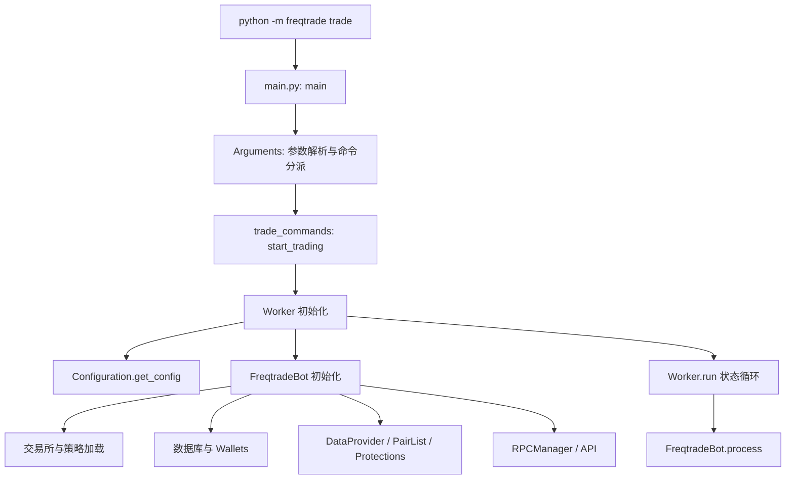

# Freqtrade 项目导航与迭代指南

这份文档回答三个问题：**项目能做什么、功能在哪实现、如何完成一次可验证的迭代。** 内容按当前仓库源码编写，包含本机新增的 BTC 模拟盘、原版 FreqUI 汉化和隐私检查。不会记录实际密码、个人邮箱或具体账户交易结果。

优先阅读：第 1～3 节建立整体认识，第 5～7 节理解交易链路，第 11～14 节开始开发。需要查某个功能时，直接使用第 4 节的功能定位表。

## 目录

1. [当前项目与本机环境](#s1)
2. [十分钟运行入口](#s2)
3. [目录地图](#s3)
4. [功能、实现位置与测试对照](#s4)
5. [启动流程和交易循环](#s5)
6. [配置如何生效](#s6)
7. [策略、行情、资金与订单](#s7)
8. [回测、参数优化和偏差分析](#s8)
9. [数据库与数据文件](#s9)
10. [后端 API 与控制通道](#s10)
11. [原版 FreqUI 与中文补丁](#s11)
12. [本仓库新增内容](#s12)
13. [常见需求的迭代方法](#s13)
14. [测试与交付流程](#s14)
15. [排查问题的入口](#s15)
16. [推荐阅读顺序与术语](#s16)

<a id="s1"></a>
## 1. 当前项目与本机环境

Freqtrade 是一个 Python 加密货币交易框架。它负责读取行情、调用策略、检查资金与交易限制、管理订单、持久化交易，并通过网页、命令行或消息通道提供控制与统计。

当前仓库有三部分：

| 部分 | 内容 | 主要位置 |
| --- | --- | --- |
| Freqtrade 上游框架 | 交易引擎、交易所适配、回测、API、测试 | `freqtrade/`、`tests/` |
| 本项目业务配置 | BTC/USDT 简单策略、模拟盘脚本 | `strategies/`、`scripts/btc-dryrun.ps1` |
| 原界面中文补丁 | 翻译字典、源码补丁、构建和安装 | `ui_zh/`、`scripts/build-frequi-zh.ps1` |

本机使用 Python 虚拟环境 `.venv` 运行源码，Python 要求见 [pyproject.toml](pyproject.toml)。当前后端版本标识见 [freqtrade/__init__.py](freqtrade/__init__.py)，属于 `2026.10-dev` 开发分支；前端汉化固定适配 FreqUI `3.1.3`。

当前启用的是 **Binance 现货 BTC/USDT、5 分钟、只做多、dry-run**。默认模拟资金 1,000 USDT，每单 100 USDT，最多一笔持仓。网页地址为 **http://127.0.0.1:8080/**，8081 的独立面板已移除。

以下能力存在于框架中，但当前配置并未全部启用：

| 能力 | 当前情况 |
| --- | --- |
| 现货模拟盘、网页查看和控制 | 已配置 |
| 命令行下载数据与回测 | 已配置 |
| 原 FreqUI 简体中文 | 已配置 |
| 实盘、合约、做空、杠杆 | 当前策略和启动器未启用 |
| 动态交易对、组合保护规则 | 框架支持，当前使用静态 BTC 交易对列表 |
| Hyperopt 参数优化 | 框架支持，需额外依赖和可优化参数 |
| FreqAI / 强化学习 | 框架支持，需模型依赖与对应策略 |
| Telegram / Discord / Webhook | 框架支持，当前未配置使用 |
| 网页回测工作台 | 使用独立 `webserver` 模式，当前 8080 是交易模式 |

<a id="s2"></a>
## 2. 十分钟运行入口

以下命令均在仓库根目录的 PowerShell 中执行，不要求先激活虚拟环境。新机器需要先安装符合 `pyproject.toml` 要求的 Python 和 Git，并能访问交易所行情；重建中文界面还需要 Node.js 与 npm。`Setup` 负责创建虚拟环境和安装 Python 项目依赖，不会安装这些系统工具。

```powershell
# 查看本机状态
powershell -NoProfile -ExecutionPolicy Bypass -File .\scripts\btc-dryrun.ps1 Status

# 检查配置、策略加载和交易对
powershell -NoProfile -ExecutionPolicy Bypass -File .\scripts\btc-dryrun.ps1 Check

# 启动后台模拟盘；已有进程时会提示，避免启动重复实例
powershell -NoProfile -ExecutionPolicy Bypass -File .\scripts\btc-dryrun.ps1 Start

# 停止模拟盘进程，保留账本
powershell -NoProfile -ExecutionPolicy Bypass -File .\scripts\btc-dryrun.ps1 Stop

# 查看最近日志
Get-Content .\user_data\logs\btc-dryrun.log -Tail 50 -Wait
```

网页用户名为 `freqtrader`，密码只在本地 `user_data/config-btc-dryrun.json` 的 `api_server.password` 中。不要把实际配置内容贴进公开文档。

第一次在新环境搭建时运行：

```powershell
powershell -NoProfile -ExecutionPolicy Bypass -File .\scripts\btc-dryrun.ps1 Setup
```

`Setup` 安装基础依赖，并在配置不存在时从模板生成本地配置与随机 API 凭据。已有本地配置不会被覆盖，因此**修改模板不会自动改变现有运行配置**。

先下载，再回测：

```powershell
powershell -NoProfile -ExecutionPolicy Bypass -File .\scripts\btc-dryrun.ps1 Download -Days 30
powershell -NoProfile -ExecutionPolicy Bypass -File .\scripts\btc-dryrun.ps1 Backtest
```

回测记录与模拟盘账本相互独立。界面没有成交记录时，可以先检查信号、持仓限制和行情更新时间；不会因启动成功就自动产生交易。

<a id="s3"></a>
## 3. 目录地图

```text
仓库根目录/
├─ freqtrade/                  Python 框架
│  ├─ main.py                  程序入口与命令分派
│  ├─ worker.py                状态机、循环、节流、重载
│  ├─ freqtradebot.py          交易流程协调器
│  ├─ wallets.py               余额、可用资金、每笔投入
│  ├─ commands/               CLI 命令、参数与入口函数
│  ├─ configuration/          配置加载、合并、校验、脱敏
│  ├─ config_schema/          配置字段定义
│  ├─ strategy/               策略接口、回调、参数、辅助函数
│  ├─ resolvers/              策略、交易所、插件、模型的加载
│  ├─ exchange/               CCXT 封装、交易所差异、模拟订单
│  ├─ data/                   行情缓存、下载、文件格式、统计
│  ├─ persistence/            交易、订单、锁定、数据库迁移
│  ├─ plugins/                交易对列表与保护规则
│  ├─ optimize/               回测、优化、偏差分析与结果报告
│  ├─ freqai/                 模型训练、预测、特征与模型管理
│  ├─ rpc/                    API、消息控制、通知与推送
│  ├─ plot/                   Python/Plotly 图表导出
│  └─ templates/              策略、配置与 FreqAI 示例
├─ strategies/                本项目可提交的策略源码
├─ config_examples/           可提交的配置模板，不含实际密钥
├─ scripts/                   CLI 客户端及本项目管理脚本
├─ ui_zh/                     可提交的原版界面汉化补丁
├─ tests/                     框架测试及测试数据
├─ ft_client/                 独立 Freqtrade REST 客户端包
├─ docs/                      随仓库提供的上游英文文档
├─ build_helpers/             构建、版本、Schema 等维护工具
├─ .github/                   CI 工作流和仓库协作配置
├─ user_data/                 本机配置、行情、账本、日志和前端副本
├─ .venv/                     本机 Python 环境
├─ pyproject.toml             包信息、依赖、开发工具配置
└─ docker-compose.yml         上游 Docker 运行示例
```

通常先改 `strategies/` 或业务配置；只有需要改变框架行为时，才进入 `freqtrade/`。`user_data/` 中的配置和产物不提交；业务源码放在根目录的 `strategies/`。

<a id="s4"></a>
## 4. 功能、实现位置与测试对照

| 功能 / 要改的行为 | 实现入口 | 对应测试入口 |
| --- | --- | --- |
| 增加或调整 CLI 命令 | [arguments.py](freqtrade/commands/arguments.py)、[cli_options.py](freqtrade/commands/cli_options.py)、`commands/*_commands.py` | [tests/commands](tests/commands) |
| 配置读取、环境覆盖、默认值 | [configuration.py](freqtrade/configuration/configuration.py)、[load_config.py](freqtrade/configuration/load_config.py)、[environment_vars.py](freqtrade/configuration/environment_vars.py) | [test_configuration.py](tests/test_configuration.py) |
| 增加配置字段或校验 | [配置 Schema](freqtrade/config_schema/config_schema.py)、[config_validation.py](freqtrade/configuration/config_validation.py) | [test_configuration.py](tests/test_configuration.py) |
| 启停、暂停、循环与重载 | [Worker](freqtrade/worker.py)、[State](freqtrade/enums/state.py) | [test_worker.py](tests/freqtradebot/test_worker.py) |
| 开仓、平仓、撤单、订单更新 | [FreqtradeBot](freqtrade/freqtradebot.py) | [test_freqtradebot.py](tests/freqtradebot/test_freqtradebot.py)、[test_integration.py](tests/freqtradebot/test_integration.py) |
| 策略信号、止损、回调 | [IStrategy](freqtrade/strategy/interface.py)、[策略辅助函数](freqtrade/strategy/strategy_helper.py) | [test_interface.py](tests/strategy/test_interface.py)、[tests/strategy](tests/strategy) |
| 本项目 EMA20/50 策略 | [BtcEmaCross.py](strategies/BtcEmaCross.py) | 本地配置检查、历史回测、偏差分析；框架策略测试不等于本策略测试 |
| 策略或插件加载失败 | [StrategyResolver](freqtrade/resolvers/strategy_resolver.py)、[IResolver](freqtrade/resolvers/iresolver.py) | [test_strategy_loading.py](tests/strategy/test_strategy_loading.py) |
| 交易所 API、精度、限额、订单 | [Exchange](freqtrade/exchange/exchange.py)、[Binance](freqtrade/exchange/binance.py)、[ExchangeResolver](freqtrade/resolvers/exchange_resolver.py) | [test_exchange.py](tests/exchange/test_exchange.py)、[tests/exchange](tests/exchange) |
| 模拟成交和模拟余额 | `Exchange.create_dry_run_order()`、`fetch_dry_run_order()`；[Wallets](freqtrade/wallets.py) 的 `_update_dry()` | [test_exchange.py](tests/exchange/test_exchange.py)、[test_wallets.py](tests/test_wallets.py) |
| 行情缓存和策略读数 | [DataProvider](freqtrade/data/dataprovider.py) | [test_dataprovider.py](tests/data/test_dataprovider.py) |
| 下载、转换和读取历史数据 | [data_commands.py](freqtrade/commands/data_commands.py)、[history_utils.py](freqtrade/data/history/history_utils.py)、[datahandlers](freqtrade/data/history/datahandlers) | [test_download_data.py](tests/data/test_download_data.py)、[test_history.py](tests/data/test_history.py)、[test_datahandler.py](tests/data/test_datahandler.py) |
| 动态交易对、白名单、黑名单 | [PairListManager](freqtrade/plugins/pairlistmanager.py)、[pairlist 插件](freqtrade/plugins/pairlist) | [test_pairlist.py](tests/plugins/test_pairlist.py) |
| 冷却、连续止损、回撤保护 | [ProtectionManager](freqtrade/plugins/protectionmanager.py)、[protections](freqtrade/plugins/protections) | [test_protections.py](tests/plugins/test_protections.py)、[test_pairlocks.py](tests/plugins/test_pairlocks.py) |
| 交易账本、订单和数据库升级 | [trade_model.py](freqtrade/persistence/trade_model.py)、[models.py](freqtrade/persistence/models.py)、[migrations.py](freqtrade/persistence/migrations.py) | [tests/persistence](tests/persistence) |
| 历史回测撮合 | [Backtesting](freqtrade/optimize/backtesting.py)、[optimize_commands.py](freqtrade/commands/optimize_commands.py) | [test_backtesting.py](tests/optimize/test_backtesting.py)、[test_backtest_detail.py](tests/optimize/test_backtest_detail.py) |
| 回测收益、回撤、分组和结果保存 | [optimize_reports](freqtrade/optimize/optimize_reports)、[metrics.py](freqtrade/data/metrics.py)、[btanalysis](freqtrade/data/btanalysis) | [test_optimize_reports.py](tests/optimize/test_optimize_reports.py)、[test_metrics.py](tests/data/test_metrics.py) |
| 参数搜索和损失函数 | [Hyperopt](freqtrade/optimize/hyperopt/hyperopt.py)、[HyperOptimizer](freqtrade/optimize/hyperopt/hyperopt_optimizer.py)、[hyperopt_loss](freqtrade/optimize/hyperopt_loss) | [test_hyperopt.py](tests/optimize/test_hyperopt.py)、[test_hyperoptloss.py](tests/optimize/test_hyperoptloss.py) |
| 前瞻偏差和递归稳定性 | [lookahead.py](freqtrade/optimize/analysis/lookahead.py)、[recursive.py](freqtrade/optimize/analysis/recursive.py) | [test_lookahead_analysis.py](tests/optimize/test_lookahead_analysis.py)、[test_recursive_analysis.py](tests/optimize/test_recursive_analysis.py) |
| 网页 API、鉴权、响应字段 | [api_server](freqtrade/rpc/api_server)、[RPC](freqtrade/rpc/rpc.py) | [test_rpc_apiserver.py](tests/rpc/test_rpc_apiserver.py)、[test_rpc.py](tests/rpc/test_rpc.py) |
| Telegram / Discord / Webhook 通知 | [RPCManager](freqtrade/rpc/rpc_manager.py)、[telegram.py](freqtrade/rpc/telegram.py)、[discord.py](freqtrade/rpc/discord.py)、[webhook.py](freqtrade/rpc/webhook.py) | [tests/rpc](tests/rpc) |
| WebSocket 与外部行情共享 | [api_ws.py](freqtrade/rpc/api_server/api_ws.py)、[message_stream.py](freqtrade/rpc/api_server/ws/message_stream.py)、[external_message_consumer.py](freqtrade/rpc/external_message_consumer.py) | [test_rpc_emc.py](tests/rpc/test_rpc_emc.py)、[test_exchange_ws.py](tests/exchange/test_exchange_ws.py) |
| FreqAI 训练与预测 | [IFreqaiModel](freqtrade/freqai/freqai_interface.py)、[data_kitchen.py](freqtrade/freqai/data_kitchen.py)、[prediction_models](freqtrade/freqai/prediction_models) | [tests/freqai](tests/freqai) |
| Python 图表导出 | [plotting.py](freqtrade/plot/plotting.py)、[plot_commands.py](freqtrade/commands/plot_commands.py) | [test_plotting.py](tests/test_plotting.py) |
| 中文文案和界面补丁 | [字典](ui_zh/zh-CN.tsv)、[localize.mjs](ui_zh/localize.mjs)、[zhLocale.ts](ui_zh/zhLocale.ts) | [localization.spec.ts](ui_zh/localization.spec.ts) |
| 提交前防泄露 | [check-private-files.py](scripts/check-private-files.py)、[.gitignore](.gitignore) | [test_check_private_files.py](scripts/test_check_private_files.py) |

`edge` 在当前源码中只是报错的兼容入口，功能已经移除；不要根据旧版 README 把它当作现有开发模块。实际行为见 `commands/optimize_commands.py::start_edge()`。

<a id="s5"></a>
## 5. 启动流程和交易循环

### 5.1 从命令到机器人



`main.py` 解析 CLI 后调用绑定的入口函数。交易命令进入 `start_trading()`，建立 `Worker`；Worker 加载配置并构建 `FreqtradeBot`。后者组合各个模块，最后进入循环。

### 5.2 一次交易循环实际做什么

核心方法是 [FreqtradeBot.process()](freqtrade/freqtradebot.py)：

1. 检查交易所市场信息，更新尚未补齐的手续费。
2. 从数据库读取当前持仓，刷新可交易对列表。
3. `DataProvider.refresh()` 获取交易对和辅助周期的行情。
4. 调用策略 `bot_loop_start()`，随后 `strategy.analyze()` 计算指标和信号。
5. `manage_open_orders()` 处理已有订单的成交、超时、撤销等状态。
6. `exit_positions()` 优先处理现有持仓的退出。
7. 若策略启用了仓位调整，再处理加减仓。
8. 状态为 `RUNNING` 且存在空闲持仓名额时，`enter_positions()` 检查新入场。
9. 提交数据库变化，处理调度和通知，更新 `last_process` 心跳时间。

**策略产生信号不等于订单已经成交。** 后续还要经过锁定、持仓名额、资金、交易所限制、价格和订单状态检查。

### 5.3 进程和交易状态是两回事

| 状态 / 操作 | 行为 |
| --- | --- |
| `RUNNING` | 管理持仓，并检查新入场 |
| `PAUSED` | 继续管理持仓，暂停新入场；当前实现也会限制暂停期间的增仓，按相关代码路径检查 |
| `STOPPED` | 停止正常交易处理，进程和网页 API 可继续存在 |
| `RELOAD_CONFIG` | Worker 重建配置与机器人实例 |
| 网页“停止” / API `/stop` | 修改交易状态，不直接终止 Python 进程 |
| 本机脚本 `Stop` | 先请求停止交易，再结束 Windows Python 进程及其启动器 |

Worker 的循环节流由 `internals.process_throttle_secs` 控制。`process_only_new_candles=True` 控制策略是否重复分析同一根 K 线，**并不表示所有订单管理都只在 K 线更新时执行**。

<a id="s6"></a>
## 6. 配置如何生效

### 6.1 模板与实际配置

| 文件 | 用途 |
| --- | --- |
| [btc_dryrun.example.json](config_examples/btc_dryrun.example.json) | 可提交的初始模板；凭据为空 |
| `user_data/config-btc-dryrun.json` | 当前运行配置；包含本地 API 密码与密钥，不提交 |
| [configuration.py](freqtrade/configuration/configuration.py) | 文件、环境变量和 CLI 的解析与合并 |
| [config_schema.py](freqtrade/config_schema/config_schema.py) | 类型、必填项、允许值和默认值 |
| [config_validation.py](freqtrade/configuration/config_validation.py) | 字段间的业务约束 |
| [strategy_resolver.py](freqtrade/resolvers/strategy_resolver.py) | 将有效配置覆盖到策略属性上 |

一般优先级是：**CLI 参数 → 环境变量 → 配置文件 → 策略属性 → 默认值**。多个配置文件还有合并顺序，最终结果应以 `show-config` 和启动日志为准。

本机启动器为保持固定执行上下文，拒绝 `FREQTRADE__*` 环境覆盖，且明确传入 `--dry-run`、`--strategy BtcEmaCross` 和 `--strategy-path strategies`。

因此：

- 改每笔资金、最大持仓、交易对等，先看实际运行 JSON。
- 改指标和信号，改策略 Python 文件。
- 若 JSON 定义了 `stoploss`、`timeframe` 等字段，会覆盖策略同名属性。
- 修改 `config.strategy` 不会覆盖启动器明确指定的 `BtcEmaCross`。
- 修改模板不会覆盖已经生成的运行 JSON。

### 6.2 增加一个配置字段需要改哪里

先在配置 Schema 声明字段，再在 `config_validation.py` 添加必要的交叉校验，最后在实际业务模块读取它。若字段也要从命令行设置，还需修改 `cli_options.py`、`arguments.py` 与 Configuration 的对应处理。

不要只在 JSON 写一个新字段就认为它产生了效果：**必须存在消费该字段的代码**。

当前本机检查器会直接加载策略并校验有效配置，因为 `main.py` 的部分 `ConfigurationError` 路径可能以空退出码结束；遇到失败时还应检查日志内容。

<a id="s7"></a>
## 7. 策略、行情、资金与订单

### 7.1 策略的三个基础方法

当前策略：[strategies/BtcEmaCross.py](strategies/BtcEmaCross.py)。框架接口：[IStrategy](freqtrade/strategy/interface.py)。

| 方法 | 输入 / 输出 | 当前实现 |
| --- | --- | --- |
| `populate_indicators()` | 接收 OHLCV DataFrame，返回包含指标的 DataFrame | 新增 `ema_fast` 与 `ema_slow` |
| `populate_entry_trend()` | 写入入场信号及标签 | EMA20 上穿 EMA50 时设置 `enter_long=1` |
| `populate_exit_trend()` | 写入退出信号及标签 | EMA20 下穿 EMA50 时设置 `exit_long=1` |

基础行情列通常是 `date`、`open`、`high`、`low`、`close`、`volume`。`metadata['pair']` 是当前交易对。

`shift(1)` 取得前一根 K 线的数据，用来判断“发生交叉”而不只是“当前快线高于慢线”。策略当前不使用未来行数据。

框架调用链：

```text
IStrategy.analyze()
  -> analyze_pair()
  -> _analyze_ticker_internal()
  -> analyze_ticker()
  -> advise_indicators() -> populate_indicators()
  -> advise_entry()      -> populate_entry_trend()
  -> advise_exit()       -> populate_exit_trend()
```

框架会校验返回数据是否破坏原始行情结构，并缓存分析后的结果；图表也读取这份分析数据。

### 7.2 信号之外还有退出机制

当前策略还声明了：`minimal_roi={"0": 0.02}`、`stoploss=-0.03`、`use_exit_signal=True`。退出判断由 `IStrategy.should_exit()` 与交易引擎协调执行，覆盖退出信号、ROI、止损和相关回调。

所以即使没有均线死叉，也可能因 ROI 或止损退出；不能只看 `populate_exit_trend()` 推断全部平仓行为。

扩展策略时常用的回调：

| 回调 / 属性 | 用途 |
| --- | --- |
| `custom_exit()` | 按持仓和实时状态返回自定义退出原因 |
| `custom_stoploss()` + `use_custom_stoploss` | 自定义动态止损 |
| `custom_roi()` + `use_custom_roi` | 自定义 ROI 阈值 |
| `custom_stake_amount()` | 自定义每笔投入金额 |
| `confirm_trade_entry()` / `confirm_trade_exit()` | 下单前最后确认 |
| `adjust_trade_position()` + `position_adjustment_enable` | 加仓或减仓 |
| `custom_entry_price()` / `custom_exit_price()` | 自定义订单价格 |
| `informative_pairs()` / `@informative` | 使用其他交易对或周期的数据 |
| `protections` | 声明策略需要的保护规则 |
| `plot_config` | 指定图表中展示的指标和子图 |

具体签名与默认行为以接口源码为准，更多说明见 [strategy-callbacks.md](docs/strategy-callbacks.md)。

### 7.3 行情、资金和下单分别在哪里

| 问题 | 关键代码 |
| --- | --- |
| 行情从哪里来 | `Exchange.refresh_latest_ohlcv()`，调用交易所封装 |
| 策略如何读行情 | `DataProvider.get_pair_dataframe()`、`get_analyzed_dataframe()` |
| 金额如何确定 | `Wallets.get_trade_stake_amount()`、`validate_stake_amount()` |
| 为什么没有开仓 | `FreqtradeBot.enter_positions()`、`create_trade()` |
| 订单如何发出 | `FreqtradeBot.execute_entry()` → `Exchange.create_order()` |
| 模拟订单在哪里分支 | `Exchange.create_order()` 的 `dry_run` 分支 → `create_dry_run_order()` |
| 已有持仓如何退出 | `exit_positions()` → `handle_trade()` → 策略退出判断 → `execute_trade_exit()` |
| 未成交单如何处理 | `manage_open_orders()`、`handle_cancel_order()`、`update_trade_state()` |

`Exchange` 封装了 CCXT，交易所子类处理特定差异。模拟盘仍读取真实市场行情，但订单由本地模拟成交逻辑处理，不使用真实交易所订单，也不等于交易所测试网。

<a id="s8"></a>
## 8. 回测、参数优化和偏差分析

### 8.1 历史回测链路

```text
backtesting CLI
  -> commands/optimize_commands.py::start_backtesting()
  -> Backtesting.start()
  -> load_bt_data() 读取本地行情
  -> 指标与信号预处理
  -> backtest_one_strategy() / backtest() / backtest_loop()
  -> 回测开仓与退出模拟
  -> optimize_reports 计算统计并保存结果
```

回测复用策略接口，但有自己的撮合与推进逻辑，**不直接运行实时 Worker**。`Backtesting._get_ohlcv_as_lists()` 对信号进行移位处理，以避免把当前 K 线计算完成的信号提前用于交易。

需要区分三类数据：

- 历史行情：`user_data/data/`。
- 回测结果：`user_data/backtest_results/`。
- 模拟盘真实执行记录：`user_data/trades-btc.dryrun.sqlite`。

修改手续费、止损、细分周期、同根 K 线内的成交假设等，会改变回测结果；相关实现从 `backtesting.py` 的 `_enter_trade()`、`_check_trade_exit()` 和 `backtest_loop()` 查起。

### 8.2 Hyperopt 参数搜索

入口为 `Hyperopt.start()`，由 `HyperOptimizer` 执行参数化回测并使用损失函数评价结果。策略参数定义见 [parameters.py](freqtrade/strategy/parameters.py)，搜索空间与参数加载见 [hyper.py](freqtrade/strategy/hyper.py)。

当前 `BtcEmaCross` 使用固定的 20/50 周期，并没有声明可优化参数。要做参数搜索，先把目标变量改为 `IntParameter` 等参数，再定义明确的搜索空间和评价方式。额外依赖见 `pyproject.toml` 的 `hyperopt`。

### 8.3 检查两类常见偏差

```powershell
# 检查是否使用未来数据；历史数据应先下载到本地
.\.venv\Scripts\python.exe -m freqtrade lookahead-analysis --config user_data/config-btc-dryrun.json --strategy BtcEmaCross --strategy-path strategies --pairs BTC/USDT --timeframe 5m

# 检查指标是否明显依赖预热长度
.\.venv\Scripts\python.exe -m freqtrade recursive-analysis --config user_data/config-btc-dryrun.json --strategy BtcEmaCross --strategy-path strategies --pairs BTC/USDT --timeframe 5m --startup-candle 200 400 800
```

分析需要足够的数据与信号；没有达到分析条件不能视为“已证明没有偏差”。较长的预热测试也需要提前下载足够行情。实现与解释见 [lookahead-analysis.md](docs/lookahead-analysis.md)、[recursive-analysis.md](docs/recursive-analysis.md)。

### 8.4 FreqAI 的职责

`IFreqaiModel.start()` 连接策略与模型工作流。`FreqaiDataKitchen` 处理特征、过滤和数据准备，`FreqaiDataDrawer` 管理模型及历史产物，`prediction_models/` 放具体模型实现，`RL/` 为强化学习。

FreqAI 预测不是订单执行器：模型输出仍由策略和交易引擎决定如何使用。当前 EMA 策略未启用 FreqAI；需要单独安装相关可选依赖，不能仅靠改网页选项启用。

<a id="s9"></a>
## 9. 数据库与数据文件

### 9.1 关键持久化模型

| 模型 / 文件 | 保存内容 |
| --- | --- |
| `Trade`，`trade_model.py` | 一笔持仓及其价格、时间、手续费、盈亏和退出原因 |
| `Order`，`trade_model.py` | 属于交易的具体订单、成交数量和状态 |
| `PairLock`，`pairlock.py` | 交易对锁定记录 |
| `WalletHistory`，`wallet_history.py` | 历史钱包快照 |
| `_CustomData`，`custom_data.py` | 策略附加到交易的自定义数据 |
| 键值存储，`key_value_store.py` | 部分运行状态与元数据 |

`models.py::init_db()` 初始化 SQLAlchemy 引擎与会话，`migrations.py` 和 `db_migration.py` 处理结构升级。

新增字段要同时考虑：模型、旧库迁移、JSON 输出、API Schema、前端类型、统计，以及模拟盘和回测两条路径。只改 ORM 字段不足以完成整个功能。

### 9.2 行情文件不是交易账本

`history/datahandlers/` 抽象了 Feather、Parquet、JSON 等格式；下载和读取入口在 `history_utils.py`。交易统计则主要来自数据库中的 Trade/Order。

当前账本使用 SQLite。机器人运行期间可能同时存在主文件及 `-wal`、`-shm` 文件。做备份时使用 SQLite 的备份方式，或先正常停止机器人再复制；不要把运行中的单个主文件副本当作一定完整的账本。

<a id="s10"></a>
## 10. 后端 API 与控制通道

### 10.1 网页请求如何进入业务代码


API 统一前缀为 `/api/v1`。路由挂载和运行模式限制在 [webserver.py](freqtrade/rpc/api_server/webserver.py)，响应定义在 [api_schemas.py](freqtrade/rpc/api_server/api_schemas.py)，业务统计与控制操作集中在 [rpc.py](freqtrade/rpc/rpc.py)。

| 请求 | 用途 | 路由文件 | 业务方法 / 数据来源 |
| --- | --- | --- | --- |
| `GET /ping` | 检查 HTTP 服务 | `api_v1.py` | 只表示 API 可响应 |
| `POST /token/login` | 登录获取令牌 | `api_auth.py` | 校验本地 API 凭据 |
| `POST /token/refresh` | 刷新访问令牌 | `api_auth.py` | 校验刷新令牌 |
| `GET /show_config` | 有效配置和交易状态 | `api_v1.py` | `RPC._rpc_show_config()` |
| `GET /health` | 交易循环心跳 | `api_v1.py` | 机器人 `last_process` |
| `GET /balance` | 余额 | `api_trading.py` | `RPC._rpc_balance()` |
| `GET /profit` | 收益统计 | `api_trading.py` | `RPC._rpc_trade_statistics()` |
| `GET /status` | 当前持仓 | `api_trading.py` | `RPC._rpc_trade_status()` |
| `GET /trades` | 已平仓历史记录 | `api_trading.py` | `RPC._rpc_trade_history()`；支持 `limit/offset` |
| `GET/POST /pair_candles` | 策略分析后的 K 线 | `api_trading.py` | `RPC._rpc_analysed_dataframe()` |
| `POST /start`、`/stop`、`/pause` | 交易状态控制 | `api_trading.py` | `_rpc_start()`、`_rpc_stop()`、`_rpc_pause()` |
| `POST /forceenter`、`/forceexit` | 强制开仓或平仓 | `api_trading.py` | 相应 RPC 方法；仍需满足功能开关和规则 |
| `GET /logs` | 查看日志 | `api_v1.py` | 日志缓冲区 |
| 回测 / 数据下载 / 分析接口 | 研究工作台 | `api_backtest.py`、`api_download_data.py`、`api_analysis.py` | 相应后台任务与研究模块 |

`/ping` 返回正常，不代表策略循环正常。判断策略是否工作，需要同时看 `/show_config` 的状态、`/health` 的更新时间，以及行情是否刷新。

### 10.2 鉴权与运行模式

API 支持 Basic 鉴权和 JWT；实现是 `api_auth.py::http_basic_or_jwt_token()`。交易所密钥与网页 API 密码是两组不同凭据。

`deps.py::is_trading_mode()` 限制持仓、交易控制等路由；`is_webserver_mode()` 限制网页回测、数据下载和研究功能。**`trade --dry-run` 和 `webserver` 是不同运行模式**，不是把机器人暂停后就变成了回测工作台。

需要网页研究工作台时，可将本地运行配置复制到 `user_data/config-webserver.local.json`，把 API 端口改为 `8082`，再单独启动：

```powershell
.\.venv\Scripts\python.exe -m freqtrade webserver --config user_data/config-webserver.local.json --userdir user_data
```

这是可选的第二个服务，不会由现有 BTC 启动脚本自动创建。当前已经使用的 8080 端口不能被另一个服务重复占用。回测所用自定义策略目录还需通过适用配置提供，例如 `strategy_path`。

### 10.3 消息控制与客户端

`RPCManager` 将同一套业务能力接到 REST API、Telegram、Discord 和 Webhook。支持队列的通知模块有自己的工作线程，避免慢消息发送阻塞交易循环。

`ft_client/freqtrade_client/ft_rest_client.py` 是 REST 客户端实现；`scripts/rest_client.py`、`scripts/ws_client.py` 提供相应客户端入口。外部集成优先调用 API，而不是直接操作运行中的数据库。

<a id="s11"></a>
## 11. 原版 FreqUI 与中文补丁

### 11.1 前端源码、补丁与产物的位置

| 内容 | 位置 | 是否作为本项目提交 |
| --- | --- | --- |
| 官方前端源码副本 | `user_data/frequi-zh/` | 否，下载和试验用 |
| 中文字典与持久补丁 | `ui_zh/` | 是 |
| 官方前端构建输出 | `user_data/frequi-zh/dist/` | 否 |
| 后端正在提供的静态资源 | `freqtrade/rpc/api_server/ui/installed/` | 否，生成产物 |

前端基于 Vue 3、TypeScript、Pinia、Vue Router、Nuxt UI 和 ECharts，构建使用 Vite。它与 Python 后端是两个独立代码库，由 HTTP/WebSocket 连接。

### 11.2 页面功能在哪里实现

下表链接指向本机的官方前端副本；重新克隆本项目后，需先运行汉化构建脚本获取该副本。所有前端业务源码都在该副本的 `src/` 下：

| 网页功能 | 页面 / 组件 | 数据与状态层 |
| --- | --- | --- |
| 导航、主题、布局入口 | [NavBar.vue](user_data/frequi-zh/src/components/layout/NavBar.vue)、[NavFooter.vue](user_data/frequi-zh/src/components/layout/NavFooter.vue)、[ThemeSelect.vue](user_data/frequi-zh/src/components/ThemeSelect.vue) | [settings.ts](user_data/frequi-zh/src/stores/settings.ts)、[layout.ts](user_data/frequi-zh/src/stores/layout.ts)、[colors.ts](user_data/frequi-zh/src/stores/colors.ts) |
| 登录、编辑机器人连接 | [BotLogin.vue](user_data/frequi-zh/src/components/BotLogin.vue)、[LoginModal.vue](user_data/frequi-zh/src/components/LoginModal.vue) | [loginInfo.ts](user_data/frequi-zh/src/composables/loginInfo.ts)、[api.ts](user_data/frequi-zh/src/composables/api.ts)、[ftbotwrapper.ts](user_data/frequi-zh/src/stores/ftbotwrapper.ts) |
| 交易综合页面 | [trade.vue](user_data/frequi-zh/src/pages/trade.vue) | [ftbot.ts](user_data/frequi-zh/src/stores/ftbot.ts)、`ftbotwrapper.ts`、`layout.ts` |
| 启停、暂停和强制交易 | [BotControls.vue](user_data/frequi-zh/src/components/ftbot/BotControls.vue)、[ForceEntryForm.vue](user_data/frequi-zh/src/components/ftbot/ForceEntryForm.vue)、[ForceExitForm.vue](user_data/frequi-zh/src/components/ftbot/ForceExitForm.vue) | `ftbot.ts::startBot/stopBot/stopBuy/forceentry/forceexit` |
| 多机器人总览 | [dashboard.vue](user_data/frequi-zh/src/pages/dashboard.vue)、[BotComparisonList.vue](user_data/frequi-zh/src/components/ftbot/BotComparisonList.vue) | `ftbotwrapper.ts` |
| 持仓、历史交易与详情 | [open_trades.vue](user_data/frequi-zh/src/pages/open_trades.vue)、[trade_history.vue](user_data/frequi-zh/src/pages/trade_history.vue)、[TradeList.vue](user_data/frequi-zh/src/components/ftbot/TradeList.vue)、[TradeDetail.vue](user_data/frequi-zh/src/components/ftbot/TradeDetail.vue) | `ftbot.ts::getOpenTrades/getTrades`，[trades.ts](user_data/frequi-zh/src/types/trades.ts) |
| 余额与收益 | [balance.vue](user_data/frequi-zh/src/pages/balance.vue)、[BotBalance.vue](user_data/frequi-zh/src/components/ftbot/BotBalance.vue)、[BotProfit.vue](user_data/frequi-zh/src/components/ftbot/BotProfit.vue)、[BotPerformance.vue](user_data/frequi-zh/src/components/ftbot/BotPerformance.vue) | `ftbot.ts::getBalance/getProfit/getPerformance` |
| K 线、指标和图表设置 | [graph.vue](user_data/frequi-zh/src/pages/graph.vue)、[CandleChart.vue](user_data/frequi-zh/src/components/charts/CandleChart.vue)、[CandleChartContainer.vue](user_data/frequi-zh/src/components/charts/CandleChartContainer.vue)、[PlotConfigurator.vue](user_data/frequi-zh/src/components/charts/PlotConfigurator.vue) | [plotConfig.ts](user_data/frequi-zh/src/stores/plotConfig.ts)、[chartConfig.ts](user_data/frequi-zh/src/stores/chartConfig.ts)、[utils/charts](user_data/frequi-zh/src/utils/charts) |
| 回测与结果对比 | [backtest.vue](user_data/frequi-zh/src/pages/backtest.vue)、[BacktestRun.vue](user_data/frequi-zh/src/components/ftbot/BacktestRun.vue)、[BacktestResultAnalysis.vue](user_data/frequi-zh/src/components/ftbot/BacktestResultAnalysis.vue) | `ftbot.ts`、[btStore.ts](user_data/frequi-zh/src/stores/btStore.ts)、[backtest.ts](user_data/frequi-zh/src/types/backtest.ts) |
| 数据下载 | [download_data.vue](user_data/frequi-zh/src/pages/download_data.vue)、[DownloadDataMain.vue](user_data/frequi-zh/src/components/ftbot/DownloadDataMain.vue) | `ftbot.ts::startDataDownload`、后台任务状态 |
| 交易对配置 | [pairlist_config.vue](user_data/frequi-zh/src/pages/pairlist_config.vue)、[PairlistConfigurator.vue](user_data/frequi-zh/src/components/ftbot/PairlistConfigurator.vue) | [pairlistConfig.ts](user_data/frequi-zh/src/stores/pairlistConfig.ts) |
| 前瞻与递归分析 | [lookahead_analysis.vue](user_data/frequi-zh/src/pages/lookahead_analysis.vue)、[recursive_analysis.vue](user_data/frequi-zh/src/pages/recursive_analysis.vue) | 对应表单、结果组件及 `ftbot.ts` 后台任务方法 |
| 设置、日志 | [settings.vue](user_data/frequi-zh/src/pages/settings.vue)、[logs.vue](user_data/frequi-zh/src/pages/logs.vue) | `stores/settings.ts`、`ftbot.ts::getLogs` |
| 功能显示条件 | [utils/features.ts](user_data/frequi-zh/src/utils/features.ts)、[types/features.ts](user_data/frequi-zh/src/types/features.ts) | 后端 `api_version` 与运行模式 |

后端状态类型 `BotState` 位于 `src/types/types.ts`；不要寻找不存在的 `botState.ts` 文件。

### 11.3 汉化构建链路

```text
scripts/build-frequi-zh.ps1
  -> 获取固定版本官方前端副本
  -> ui_zh/localize.mjs 从固定基线重新应用中文补丁
  -> 生成 zhDictionary.json，复制 zhLocale.ts
  -> Vite build + TypeScript typecheck + 汉化测试
  -> ui_zh/install.py 备份原版并安装静态资源
  -> web_ui.py 在 8080 提供 index.html 和 assets
```

`zh-CN.tsv` 是英文到中文的字典；`localize.mjs` 用 Vue/TypeScript 语法树处理文字，同时保护 API 路径、字段和选项值。`zhDisplay()` 只翻译显示值，模型数据保持原样。

```powershell
powershell -NoProfile -ExecutionPolicy Bypass -File .\scripts\build-frequi-zh.ps1
```

**重要：直接修改 `user_data/frequi-zh/src/` 后运行完整汉化脚本，原始受跟踪源码会被还原。** 该目录适合阅读、临时验证；要保留变更，应修改 `ui_zh/zh-CN.tsv`、`zhLocale.ts` 或 `localize.mjs` 的持久补丁。

修改页面功能可先在副本中试验 `npm.cmd run dev`，确认效果后，把源码变更写成持久补丁再执行完整构建。开发服务的 `/api` 代理指向本机 8080，说明见副本中的 `vite.config.ts`。长期大规模开发前端时，应维护独立、受版本控制的前端源码项目，并调整源码获取与汉化基线流程。

不要直接编辑 `installed/assets/*.js` 或 `dist/`：它们会被下一次构建覆盖。仅替换界面文件无需停止 Python 机器人；页面更新后使用 Ctrl+F5。

<a id="s12"></a>
## 12. 本仓库新增内容

| 文件 | 职责 | 迭代注意事项 |
| --- | --- | --- |
| [BtcEmaCross.py](strategies/BtcEmaCross.py) | 具体 EMA 策略 | 入场、退出、ROI 和止损分别检查 |
| [btc_dryrun.example.json](config_examples/btc_dryrun.example.json) | 初始配置模板 | 密钥字段保持为空；本地 JSON 不会自动随模板变化 |
| [btc-dryrun.ps1](scripts/btc-dryrun.ps1) | Setup / Check / Start / Stop / Status / Download / Backtest | 固定策略、交易对和现货模拟模式 |
| [check-btc-dryrun.py](scripts/check-btc-dryrun.py) | 直接加载策略与配置，失败时返回非零退出码 | 更换策略需同步修改检查入口 |
| [build-frequi-zh.ps1](scripts/build-frequi-zh.ps1) | 汉化构建、测试与安装 | 适配固定前端版本，不是通用升级脚本 |
| [ui_zh/install.py](ui_zh/install.py) | 原界面备份、安装与恢复 | 备份仅在本机保存；更新时保留旧哈希资源 |
| [check-private-files.py](scripts/check-private-files.py) | 扫描暂存区的文件路径和内容 | 检查实际 Git 暂存内容，工作区修改不能掩盖旧暂存内容 |
| `.git/hooks/pre-commit` | 当前仓库本地提交检查入口 | 不随 Git 推送；新克隆环境需要重新启用 |
| [BTC-DRYRUN.md](BTC-DRYRUN.md) | 日常运行手册 | 适合直接操作当前模拟盘 |
| [ui_zh/README.md](ui_zh/README.md) | 汉化维护和恢复说明 | 适合界面维护 |
| `BTC-DRYRUN.local.md`、`user_data/privacy-audit.local.json` | 本机结果与检查记录 | 被忽略，不进入提交 |

本地源码和补丁应保存进 Git；密码、账本、日志、具体回测记录、依赖目录和构建产物保持本地。提交邮箱属于提交元数据，不是 `.gitignore` 能隐藏的文件内容。

<a id="s13"></a>
## 13. 常见需求的迭代方法

### 13.1 调整当前策略

例如：增加趋势过滤条件、调整 EMA 周期、增加自定义退出。

1. 在 `strategies/BtcEmaCross.py` 修改指标和信号；同时修改相关标签，避免标签与规则不一致。
2. 若需要在图表显示新指标，同步更新 `plot_config`。
3. 检查有效配置是否覆盖了策略参数。
4. 运行 `Check`、历史回测和适用的偏差分析。
5. 检查入场笔数、退出原因、手续费影响及数据范围；将具体结果保存在 `user_data/`。
6. 停止模拟盘，再启动新版本，并检查状态、心跳、行情和日志。

重新启动会沿用当前账本。若有旧持仓，新策略可能继续管理它们；进行不同版本的独立实验时，应使用单独配置与账本，而不是删除现有账本来“清空结果”。

### 13.2 添加另一个策略

新增一个继承 `IStrategy` 的类，例如 `strategies/MyStrategy.py`，先通过原生 CLI 独立回测：

```powershell
.\.venv\Scripts\python.exe -m freqtrade backtesting --config user_data/config-btc-dryrun.json --strategy MyStrategy --strategy-path strategies --cache none
```

若要让当前后台管理脚本使用它，至少同时修改：

- `scripts/btc-dryrun.ps1` 中的 `$StrategyArgs`。
- `scripts/check-btc-dryrun.py` 中的策略类名。
- 实际运行配置和模板中的策略名，避免配置描述与执行对象不一致。

当前管理脚本还限制 Binance、现货、BTC/USDT 和 dry-run。扩展多交易对或其他交易所时，也要同步调整这些边界与测试。

### 13.3 在网页新增一个统计指标

先确定指标是什么：当前持仓字段、已有统计的展示，还是需要后端新增计算。

以“在总览显示新增运行信息”为例：

1. 后端：在 `RPC._rpc_show_config()` 或合适的统计方法中产生字段。
2. API：同步修改 `ShowConfig` 或对应 Pydantic Schema，否则字段可能无法正确返回。
3. 前端类型：更新 `src/types/types.ts` 的 `BotState` 或相应领域类型。
4. 前端 Store：检查 `ftbot.ts::getState()` 等请求是否已经接收该对象。
5. 页面：在 `BotStatus.vue` 或适当的总览组件中显示，补上中文标签和空值处理。
6. 测试：覆盖后端返回值、未启用时的空值和中文显示；将前端变化保存到持久补丁。

这样可沿用已有请求，不必为每个展示字段单独创建接口。

### 13.4 增加一个独立 API

1. 确定路由应该属于交易模式还是网页研究模式。
2. 在对应 `api_*.py` 添加路由和 Schema，复用已有鉴权与 `get_rpc()` 等依赖。
3. 在 RPC 或实际领域模块实现逻辑，避免把全部业务塞在路由函数里。
4. 前端增加类型、Store 请求和组件调用。
5. 在 `tests/rpc/test_rpc_apiserver.py` 测试鉴权、运行模式、正常返回与失败路径。
6. 若功能需要前端能力判断，检查 `API_VERSION`、`src/types/features.ts` 和兼容性逻辑。

有数据库操作时，沿用现有会话上下文；不要绕过会话机制在网页线程中随意复用交易线程的数据库连接。

### 13.5 修改界面文案或布局

- 文案：优先修改 `ui_zh/zh-CN.tsv`；同一词在不同场景含义不同时，使用定向补丁。
- 状态显示：修改 `zhLocale.ts` 的显示逻辑，不要把 `market`、`long`、`5m` 等实际请求值直接改成中文。
- 布局：在源码副本定位页面/组件，临时验证后，将变化写入 `localize.mjs` 的 `patch()` 等持久步骤。
- 测试：保留模型值与 API 路径对照，并增加针对变化的组件测试。

前端版本升级需要重新核对官方提交、补丁目标和资源版本，不能只把下载标签改成最新版本。

<a id="s14"></a>
## 14. 测试与交付流程

### 14.1 当前已有与开发时需要的依赖

基础模拟盘依赖由 `requirements.txt` 与 `pip install -e .` 提供。当前环境没有安装完整开发测试套件；运行框架 pytest 前可按需安装：

```powershell
.\.venv\Scripts\python.exe -m pip install -e ".[develop]"
```

`develop` 对应 `pyproject.toml` 中的开发依赖。上游的 `requirements-dev.txt` 还包含绘图、Hyperopt、FreqAI、强化学习和文档等依赖，安装量更大；普通核心功能迭代可以先使用开发 extra，针对可选模块再补相应依赖。

### 14.2 按改动选择检查

| 改了什么 | 首选验证 |
| --- | --- |
| 策略或运行配置 | `btc-dryrun.ps1 Check`、回测、适用的偏差分析和模拟盘观察 |
| 实时交易流程 | `tests/freqtradebot/` 的对应测试 |
| 策略框架接口 | `tests/strategy/` |
| 交易所或行情 | `tests/exchange/`、`tests/data/` 的相关测试 |
| API / 统计 | `tests/rpc/test_rpc_apiserver.py`、`test_rpc.py` |
| 数据库字段或迁移 | `tests/persistence/` 与新旧结构迁移用例 |
| 回测规则 | `tests/optimize/test_backtesting.py` 及对应细分测试 |
| 中文补丁 | 完整汉化构建脚本中的 build、typecheck、组件测试 |
| 隐私检查器 | `scripts/test_check_private_files.py` |
| 仅 Markdown 文档 | 链接、命令、术语和隐私检查；无需运行全套交易测试 |

示例：

```powershell
.\.venv\Scripts\python.exe -m pytest tests/strategy/test_interface.py -q
.\.venv\Scripts\python.exe -m pytest tests/rpc/test_rpc_apiserver.py -q
.\.venv\Scripts\python.exe scripts/test_check_private_files.py -v
```

测试公共 fixtures 在 `tests/conftest.py`，其中使用 mock 隔离交易所行为。不要把 `tests/exchange_online/` 的联网检查和常规离线单测混为一谈。

CI 参考 [.github/workflows/ci.yml](.github/workflows/ci.yml)，代码风格与类型工具见 [pyproject.toml](pyproject.toml)、[.pre-commit-config.yaml](.pre-commit-config.yaml)。本机隐私钩子与上游的完整 pre-commit 工具配置不是同一个东西；安装其他钩子时，应保留隐私检查。

### 14.3 一次迭代的完成标准

1. 明确变化的触发条件和预期行为。
2. 修改业务代码，并同步配置、API Schema、类型、界面和文档中受影响的部分。
3. 使用可重复的输入验证结果；交易逻辑要看信号和订单两个阶段。
4. 运行相关检查，记录真实执行过的验证；未运行的检查单独说明。
5. 本地运行确认后，检查暂存区内容与隐私。

提交前：

```powershell
git status --short
git diff --cached --stat
git diff --cached --check
.\.venv\Scripts\python.exe scripts/check-private-files.py
```

检查器扫描的是 **Git 暂存区里的版本**。只修改工作区的敏感内容而未重新暂存，不会清除旧暂存版本。具体运行数据和实验记录继续放在被忽略的目录中。

<a id="s15"></a>
## 15. 排查问题的入口

| 现象 | 先检查什么 | 继续定位 |
| --- | --- | --- |
| 无法启动 | `.venv`、实际配置、策略能否加载 | `Check`、`check-btc-dryrun.py`、启动错误日志 |
| 找不到策略 | 类名和 `--strategy-path`，依赖是否可导入 | `StrategyResolver`、`list-strategies` |
| 没有成交 | 状态、最近 K 线、指标、信号、资金和持仓名额 | 策略 → `create_trade()` → Wallets / 锁定 |
| 有信号但未开仓 | 信号冲突、交易对锁定、规则和订单限制 | `get_entry_signal()`、`create_trade()`、`execute_entry()` |
| 未成交订单一直存在 | 超时配置、订单状态、撤单失败 | `manage_open_orders()`、`update_trade_state()` |
| 网页停止后端口仍可用 | API 停止的是交易状态 | 要终止当前后台进程，用本机脚本 `Stop` |
| API `/ping` 正常但策略不动 | `state` 与 `last_process` 是否更新 | `Worker`、`FreqtradeBot.process()` |
| 网页回测入口缺失或返回 503 | 当前连接是交易模式还是 webserver 模式 | `deps.py`、前端 `features.ts` |
| 设置改了却未生效 | CLI 覆盖、实际 JSON、环境变量、是否重启 | `show-config`、StrategyResolver 的覆盖日志 |
| 新指标不显示 | `plot_config`、已分析数据列、前端图表选择 | `DataProvider`、`CandleChart.vue`、`PlotConfigurator.vue` |
| 页面仍显示英文 | 当前 UI 版本、浏览器缓存、是否执行过 `install-ui` | `/ui_version`、汉化重建、Ctrl+F5 |
| 登录 401 | 本机 API 用户名、密码、令牌状态 | `api_auth.py`、前端 `loginInfo.ts` |
| 8080 被占用 | 是否重复启动了机器人或研究服务 | `Get-NetTCPConnection`、进程 PID 和配置端口 |
| 回测结果与模拟盘不同 | 相同策略/数据/参数/手续费、撮合假设和信号时序 | `backtesting.py`、偏差分析、实际订单日志 |
| Git 提交被隐私检查拦截 | 暂存区文件和检查类别 | `check-private-files.py`；不应靠强制加入真实配置来解决 |

最实用的代码搜索：

```powershell
# 找到某个方法的实现和调用
rg -n "execute_entry|create_trade" freqtrade tests

# 找到一个 API 的路由和前端调用
rg -n "pair_candles" freqtrade/rpc user_data/frequi-zh/src

# 找到中文对应的原文和补丁
rg -n "Dashboard|总览" ui_zh user_data/frequi-zh/src
```

<a id="s16"></a>
## 16. 推荐阅读顺序与术语

### 16.1 从快速上手到框架开发

| 阶段 | 阅读和实践 | 目标 |
| --- | --- | --- |
| 第一轮：会运行 | `BTC-DRYRUN.md` → 实际配置 → 当前策略 | 能启停、查看行情和交易状态、跑回测 |
| 第二轮：会定位 | 本文功能表 → `Worker` → `FreqtradeBot.process()` | 能区分配置、策略、订单和状态问题 |
| 第三轮：会迭代策略 | `IStrategy` → 回调 → 数据提供器 → 偏差分析 | 能添加规则并验证信号时序 |
| 第四轮：会改接口和页面 | RPC → FastAPI 路由/Schema → 前端 Store/类型 → 组件 | 能完成前后端一致的功能 |
| 第五轮：会改框架 | 交易所、持久化、回测和相应测试 | 能评估变更对多种运行模式的影响 |

第一次迭代宜限定在一个可观察的行为上，例如“给现有策略图表增加一个指标”或“在总览新增一个已有字段”。验收要求是能定位实现、复现结果并通过对应验证，而不是只让程序不报错。

### 16.2 常见术语

| 术语 | 在本项目中的含义 |
| --- | --- |
| Pair | 交易对，例如 BTC/USDT |
| Timeframe | K 线周期，例如 5m |
| OHLCV | 开、高、低、收、成交量 |
| Candle | 一根 K 线 |
| Entry / Exit | 入场 / 退出 |
| Trade | 一笔持仓及其完整生命周期 |
| Order | 属于交易的订单，一笔 Trade 可对应多个 Order |
| Stake | 单次投入资金，区别于最终币数量 |
| ROI | 框架中的按持仓时间配置的收益退出规则 |
| Dry-run | 真实行情上的本地模拟交易 |
| Backtest | 本地历史数据上的历史模拟 |
| Hyperopt | 多次参数化回测和结果搜索 |
| Informative pair | 为策略提供额外信息的交易对或周期 |
| Pairlist / Protection | 选交易对规则 / 限制后续交易的保护规则 |
| RPC | 将统计和控制能力提供给 API、消息通道的业务门面 |
| Store | 前端 Pinia 状态与请求层 |

进一步阅读：[策略开发](docs/strategy-customization.md)、[策略回调](docs/strategy-callbacks.md)、[配置](docs/configuration.md)、[机器人流程](docs/bot-basics.md)、[回测](docs/backtesting.md)、[开发指南](docs/developer.md)。这些文档随仓库提供；若行为与其他版本教程冲突，优先核对当前源码与 CLI `--help`。
